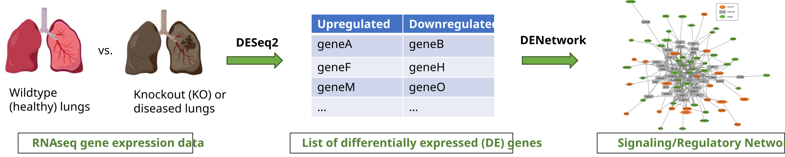

# DENetwork
Unveiling regulatory and signaling networks behind differentially-expressed genes

  * [About](#about)
  * [Installation](#installation)
  * [Repository Layout](#repository-layout)
  * [Usage](#usage)
  * [Example](#example)
  * [License](#license)
  * [Credits](#credits)
  * [Contact](#contact)
  * [Citation](#citation)


## About

<p align="justify">
Differential gene expression analysis of RNA-sequencing (RNA-seq) data offers crucial insights into biological differences between sample groups. However, the conventional focus on differentially-expressed (DE) genes often omits non-DE regulators, which are an integral part of such differences. Moreover, DE genes frequently serve as passive indicators of transcriptomic variations rather than active influencers, limiting their utility as intervention targets. To address these shortcomings, we have developed DENetwork. This innovative approach deciphers the intricate regulatory and signaling networks driving transcriptomic variations between conditions with distinct phenotypes. Unique in its integration of both DE and critical non-DE genes in a graphical model, DENetwork enhances the capabilities of traditional differential gene expression analysis tools, such as DESeq2. Our application of DENetwork to an array of simulated and real datasets showcases its potential to encapsulate biological differences, as demonstrated by the relevance and statistical significance of enriched gene functional terms. DENetwork offers a robust platform for systematically characterizing the biological mechanisms that underpin phenotypic differences, thereby augmenting our understanding of biological variations and facilitating the formulation of effective intervention strategies.
</p>

<p align="center"> 
  
</p> 


## Installation

We use OmicVerse for differential expression analysis and install the additional dependencies required to run DENetwork:

```bash
$ conda create -n omicverse python=3.10
$ conda activate omicverse
$ conda install pytorch torchvision torchaudio cpuonly -c pytorch
$ conda install pyg -c pyg
$ conda install omicverse pydeseq2 cytoolz frozendict -c conda-forge -c bioconda
$ conda install networkx matplotlib scipy kneed statsmodels openpyxl -c conda-forge
$ python -c "import omicverse, networkx, matplotlib, scipy, kneed, statsmodels, openpyxl"
```

For GPU-based installation, or other OmicVerse environments, please also see the official [OmicVerse documentation](https://omicverse.readthedocs.io/en/latest/index.html).

## Repository Layout

The repository is organized around the files needed for the OmicVerse + DENetwork workflow:

* `DENetwork/run_denetwork.py`: main DENetwork entry point
* `DENetwork/denetwork.py`: core DENetwork algorithm
* `DENetwork/simple_tools.py`: helper functions
* `DENetwork/data/ppi_ptm_pd_hgnc.txt`: default human prior network
* `DENetwork/data/ppi_biogrid_mouse.txt`: default mouse prior network
* `DENetwork/example/`: influenza example input files
* `tutorial/run_omicverse_deg.py`: OmicVerse differential expression script
* `tutorial/configs/influenza_article_standard.json`: example OmicVerse config
* `skills/denetwork-rnaseq/`: reusable assistant skill for the end-to-end RNA-seq workflow

## Usage

**1. Run differential expression analysis with OmicVerse**

```bash
$ conda activate omicverse
$ python tutorial/run_omicverse_deg.py --config tutorial/configs/influenza_article_standard.json
```

The provided config applies the article-style filtering criteria:
* `baseMean > 50`
* `padj < 0.05`
* `|log2FoldChange| >= 0.6`

The script writes DENetwork-ready files to `.tmp/tutorial_influenza_article_standard`, including:
* `DE_pos_influenza.tsv`
* `DE_neg_influenza.tsv`
* `DE_all_influenza.tsv`
* `gene_log2fc_influenza.tsv`
* `res_matrix_influenza.tsv`

You can also run the script without a config file and specify the input table and sample labels directly:

```bash
$ python tutorial/run_omicverse_deg.py \
    --input DENetwork/example/GSE192528_RawCountsAnnotated.xlsx \
    --name influenza \
    --output-dir tutorial/output_influenza \
    --gene-column Gene \
    --treatment-pattern influenza \
    --control-pattern uninfected \
    --treatment-label influenza \
    --control-label uninfected
```

**2. Run DENetwork**

```bash
$ conda activate omicverse
$ python DENetwork/run_denetwork.py \
    -n influenza \
    -d .tmp/tutorial_influenza_article_standard/DE_pos_influenza.tsv \
    -g .tmp/tutorial_influenza_article_standard/gene_log2fc_influenza.tsv \
    -r DENetwork/example/receptors_influenza.txt \
    -t de \
    -s 100
```

By default, `run_denetwork.py` uses the human prior network. Add `--species mouse` to use `DENetwork/data/ppi_biogrid_mouse.txt`.

For all options:

```bash
$ python DENetwork/run_denetwork.py -h
```

Output files are written to:
* `DENetwork/results/<model_name>/`
* `DENetwork/files/<model_name>/`
* `DENetwork/figures/<model_name>/`

**3. Use with an assistant (optional)**

You can hand the workflow to any capable LLM assistant as a structured prompt. The assistant should:
* inspect the count matrix format
* confirm which samples are controls and which are treatments
* ask whether to use upregulated or downregulated targets
* determine whether the dataset is human or mouse
* use a provided receptor list, or generate one from CellTalkDB if none is available
* run OmicVerse first and DENetwork second

A useful prompt template is:

```text
Use this RNA-seq count matrix to run OmicVerse differential expression and then DENetwork.
Input file: <count_matrix>
Controls are <control samples>.
Treatments are <treatment samples>.
Use upregulated targets.  # or downregulated targets
This is human data.       # or mouse data
Use this receptor file: <path>.  # or generate one from CellTalkDB
```

If you use Codex locally, the same workflow is also available as the `$denetwork-rnaseq` skill.

Provide these items whenever possible:
* the input count matrix
* which samples are controls and which are treatments
* whether to use upregulated or downregulated targets
* the species (`human` or `mouse`)
* a receptor list, if you already have one

If a receptor list is not available, the skill can generate one from CellTalkDB. Species can often be inferred, but control and treatment samples should be stated explicitly.

To use the repository copy directly with Codex, point to the skill path explicitly:

```text
Use $denetwork-rnaseq at /path/to/DENetwork/skills/denetwork-rnaseq on <count_matrix>.
```

To make it auto-discoverable in Codex, copy or symlink the folder into `~/.codex/skills/`.


## Example

The included influenza example uses:
* `DENetwork/example/GSE192528_RawCountsAnnotated.xlsx`
* `DENetwork/example/receptors_influenza.txt`
* `DENetwork/data/ppi_ptm_pd_hgnc.txt`

Run the full example with:

```bash
$ conda activate omicverse
$ python tutorial/run_omicverse_deg.py --config tutorial/configs/influenza_article_standard.json
$ python DENetwork/run_denetwork.py -n influenza -d .tmp/tutorial_influenza_article_standard/DE_pos_influenza.tsv -g .tmp/tutorial_influenza_article_standard/gene_log2fc_influenza.tsv -r DENetwork/example/receptors_influenza.txt -t de -s 100
```

This produces:
* `DENetwork/results/influenza/optimal_network.sif`
* `DENetwork/results/influenza/optimal_network.noa`
* `DENetwork/results/influenza/nodes_ranking.tsv`
* `DENetwork/results/influenza/genes_go.txt`
* `DENetwork/files/influenza/`
* `DENetwork/figures/influenza/`

The `.sif` and `.noa` files can be imported into Cytoscape, and the `*_go.txt` files can be used for enrichment analysis.

To systematically identify statistically significant key genes from DENetwork results, we employ a permutation-based statistical inference framework. For each dataset, we repeatedly randomize the edges of the PPI network (preserving node number and degree distribution), and run DENetwork on each permuted network to generate over 100,000 background gene scores, which together define an empirical null distribution. The statistical significance threshold is set at the empirical score corresponding to the top 5% of the background distribution. Any gene from the real network with a DENetwork score exceeding this threshold is considered a high-confidence regulatory candidate. This approach removes subjective cutoffs and ensures robust, statistically grounded gene prioritization.

Please use the provided random PPI network files to run DENetwork to generate the background score distribution, and select key genes with DENetwork scores above the 5% of this background as significant candidates.

## License
DENetwork is licensed under the terms of the MIT license.

## Credits
DENetwork was developed by the Ding Lab @ McGill University.

## Contact
Jun Ding jun.ding@mcgill.ca <br />
Bowen Zhao bowen.zhao@mail.mcgill.ca <br />
Ting-Yi Su ting-yi.su@mail.mcgill.ca

## Citation

```
@article{zhao2025denetwork,
  title={DENetwork unveils non-differentially expressed genes with functional relevance across conditions through information flow perturbation},
  author={Zhao, Bowen and Su, Ting-Yi and Wang, Jingtao and Islam, Quazi S and Song, Kailu and Huang, Steven K and Allez, Matthieu and Fonseca, Gregory J and Baglole, Carolyn J and Ding, Jun},
  journal={Nucleic Acids Research},
  volume={53},
  number={22},
  pages={gkaf1350},
  year={2025},
  publisher={Oxford University Press}
}
```
